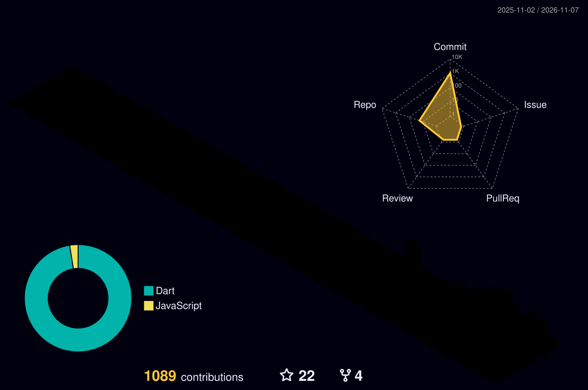

<!-- ============================================================
  fnthinklevi · GitHub Profile README
  说明：
  1) 贪吃蛇动画与 3D 贡献图由 GitHub Actions 自动生成（见本项目 .github/workflows/），
     需要把两个 yml 放入 fnthinklevi/fnthinklevi 仓库后手动触发一次。
  2) 各特效服务的本地实现版本见本项目的 index.html（纯本地渲染，无外部依赖）。
============================================================ -->

  

  

  

    
    
    
    
    
    
  

## 🧠 About Me

- 🔭 正在做 **AI for Data**：LLM Agent 编排、工具调用与多模态数据流水线
- 🌱 正在探索 **RAG 评测 · Agent 记忆机制 · 多模态理解**
- 👯 希望协作 **数据驱动型开源项目 / AI 应用**
- 💬 可以聊聊 **Python · PyTorch · 数据工程 · LLM 应用**
- ⚡ 一句话：*Data-Driven · Agent-Powered · Vision-Aware*

`Python` `PyTorch` `LLM Agents` `RAG` `Multimodal` `Data Engineering` `Docker`

<h2 align="center">
  
  Skills & Tools
</h2>

  

## 📊 GitHub Stats

  
  

<h2 align="center">
  
  Contributions
  
</h2>

  
  
  

<h2 align="center">
  
  GitHub Activity
  
</h2>

<picture>
  <source media="(prefers-color-scheme: dark)" srcset="https://raw.githubusercontent.com/fnthinklevi/fnthinklevi/output/github-contribution-grid-snake-dark.svg">
  <source media="(prefers-color-scheme: light)" srcset="https://raw.githubusercontent.com/fnthinklevi/fnthinklevi/output/github-contribution-grid-snake.svg">
  
</picture>

  <i>Thanks for visiting — let's build something intelligent together.</i>

