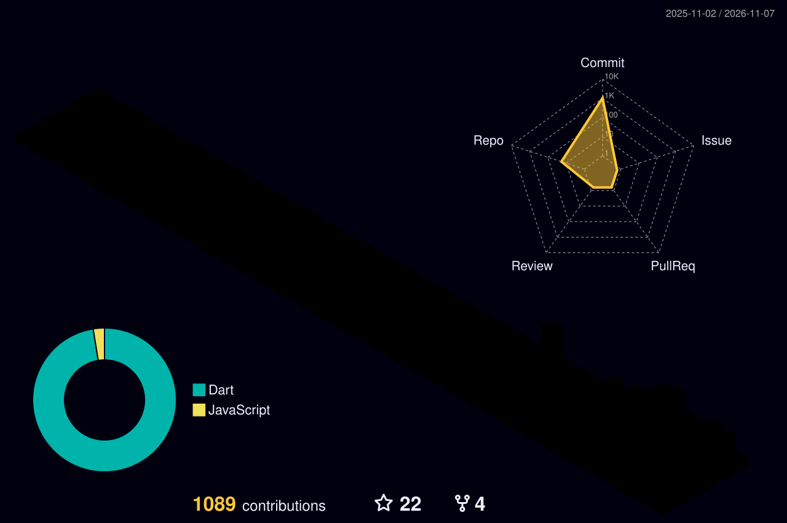

<!-- ============================================================
  fnthinklevi · GitHub Profile README（中文版）
  说明：
  1) 贪吃蛇动画与 3D 贡献图由 GitHub Actions 自动生成（见 .github/workflows/），
     首次放入仓库后需手动触发一次。
  2) 各特效的纯本地渲染版本见 index.html（无外部依赖）。
============================================================ -->

  <a href="README.md">English</a> | <a href="README.zh-CN.md">简体中文</a>

  

  

  

    
    
    
    
    
    
  

## 🧠 关于我

- 📱 正在做 **Android 应用开发**：Kotlin / Java，关注性能、架构与用户体验
- 🕊️ 同时用 **Flutter / Dart** 做跨端应用，一套代码多端运行
- 🌐 也在做 **网站开发**：从页面还原、交互逻辑到接口联调与部署上线
- 💬 可以聊聊 **Android · Flutter · Dart · Web 前端**
- ⚡ 一句话：*Mobile-First · Cross-Platform · Web-Ready*

`Android` `Flutter` `Dart` `Kotlin` `Java` `JavaScript` `HTML/CSS` `Git`

<h2 align="center">
  
  技能与工具
</h2>

  

<h2 align="center">
  
  贡献
  
</h2>

  
  
  

<h2 align="center">
  
  GitHub 动态
  
</h2>

<picture>
  <source media="(prefers-color-scheme: dark)" srcset="https://raw.githubusercontent.com/fnthinklevi/fnthinklevi/output/github-contribution-grid-snake-dark.svg">
  <source media="(prefers-color-scheme: light)" srcset="https://raw.githubusercontent.com/fnthinklevi/fnthinklevi/output/github-contribution-grid-snake.svg">
  
</picture>

  <i>感谢来访 — 一起打造出色的应用。</i>

